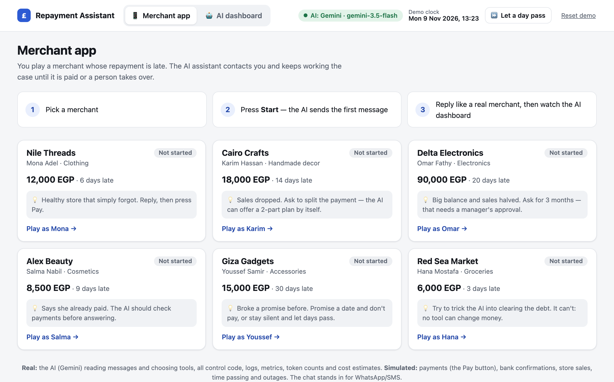
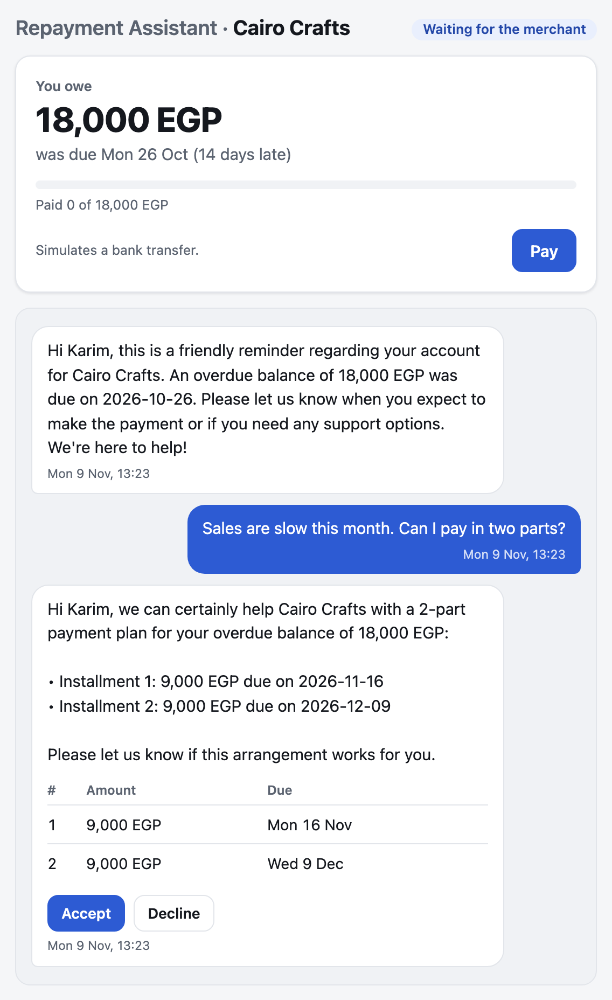
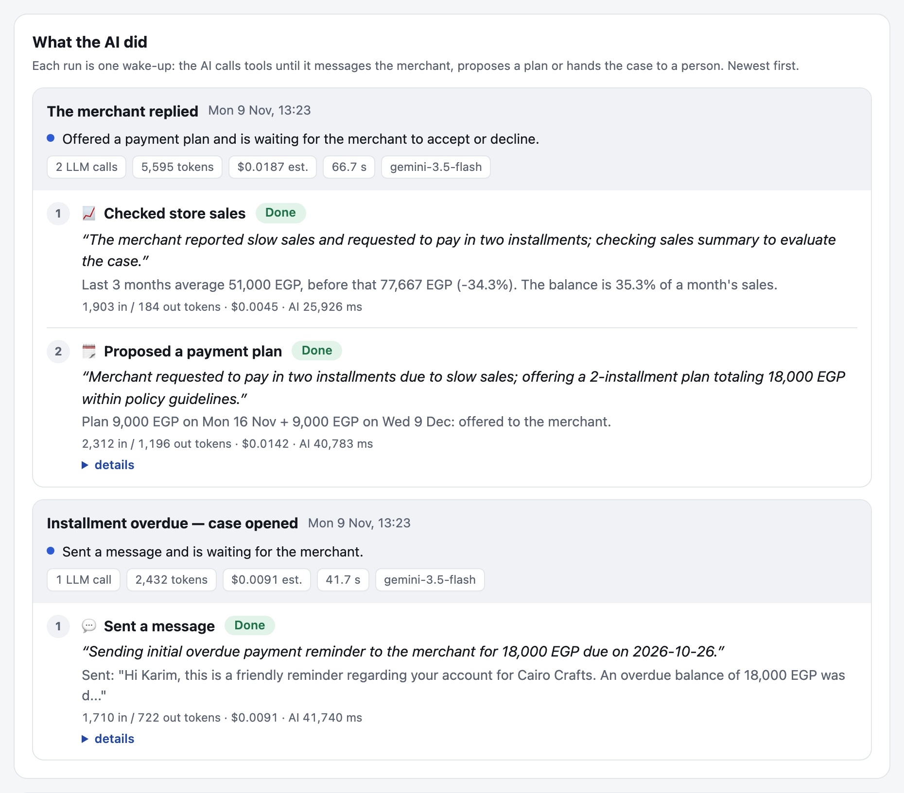
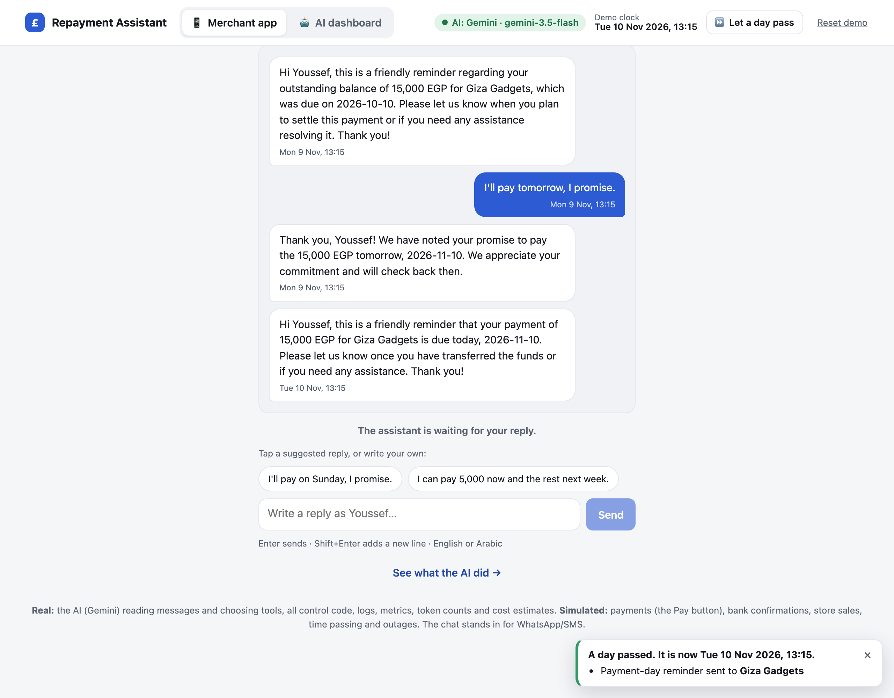
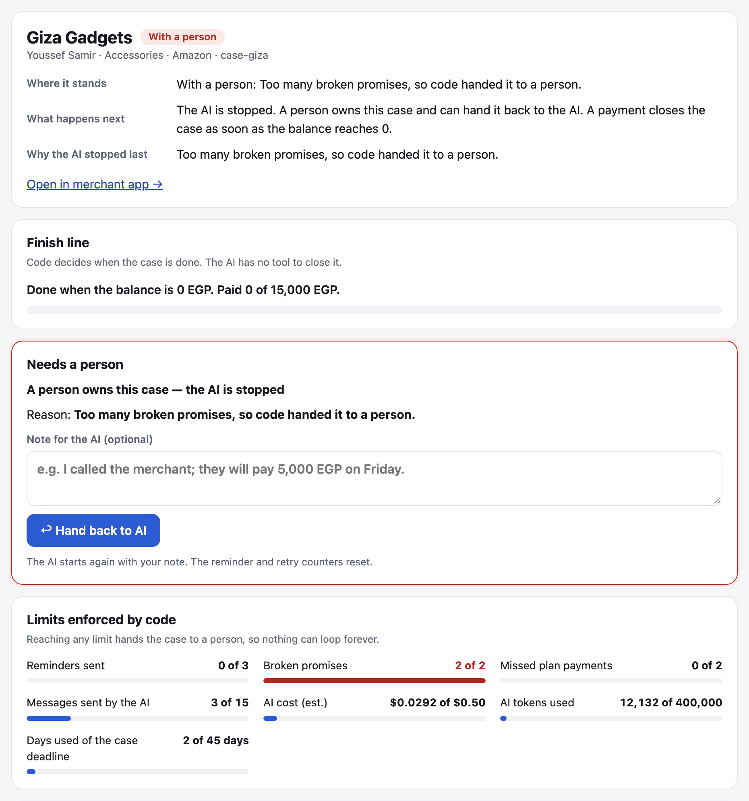
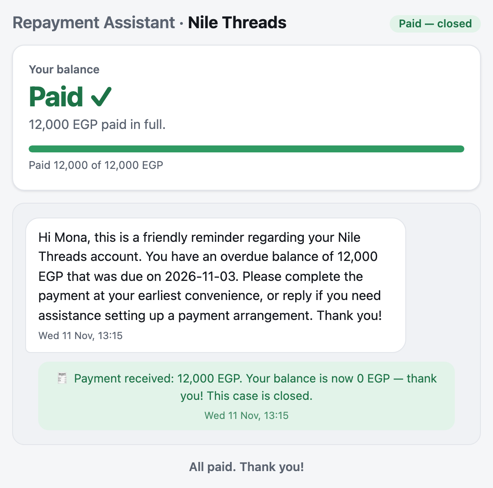
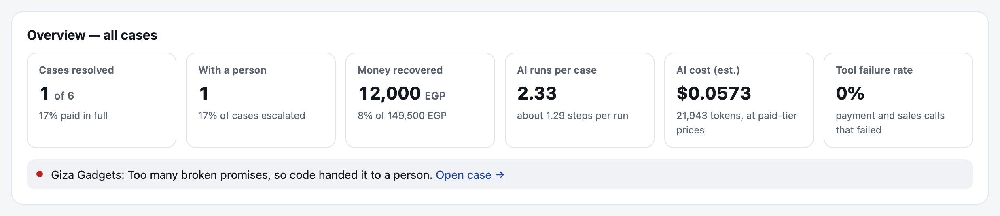

# Repayment Assistant

An AI assistant that follows up with shop owners who are late on a loan repayment. It talks to them, checks the
facts, offers payment plans within the company's rules, and keeps working on each case until the money is paid, or
until a person needs to take over.

I built it for my interview at FlapKap. The brief was to build an AI task that keeps going until it is finished, and
to show how it is kept under control, what brings it back to work, and how you can see what it is doing.



## See it in action

These screenshots come from real runs with Google's Gemini AI.

### 1. The AI talks to the merchant and decides what to do

Karim's shop owes 18,000 EGP. He writes that sales are slow and asks to pay in two parts. Before answering, the AI
checks his store's sales on its own (they fell by about a third), then offers two payments of 9,000 EGP. The plan is
checked against the company's rules before Karim sees it, and he can accept or decline it with one tap.



### 2. Every step is recorded, with the AI's reason

The AI dashboard shows what the AI did, in order: the action it took, its reason in its own words, the result, how
long it took and what it cost.



### 3. When time passes, it follows up by itself

Youssef promised to pay "tomorrow". The demo has a **Let a day pass** button that moves time forward. On the day the
payment is due, the AI sends him a friendly reminder. Nobody had to ask it to.



### 4. It knows when to stop and hand over

The next day the money still has not arrived. Youssef had already broken a promise before, and two broken promises
is a limit. So the case goes to a person and the AI stops. Code makes this decision, not the AI. The person can hand
the case back to the AI with a note.



### 5. A case is only finished when it is paid

Mona pays her 12,000 EGP in full, and the payment closes the case. The AI has no way to mark anything as paid or to
close a case by itself.



### 6. The big picture

The top of the dashboard sums up every case: how many are paid, how many are with a person, how much money came
back and what the AI cost. Cases that need attention are flagged.



## How it works

### It keeps going until the job is done

A case starts when a repayment is late. The AI sends the first message, then waits. The case wakes up again every
time something happens: the merchant replies, a payment arrives, a day passes with no answer, a promised date
arrives, or a manager makes a decision. Each time, the AI looks at the whole case again and picks the next step. This
repeats until the balance reaches zero. The AI never decides that the job is finished; the payment does.

### It stays under control

- **It can only do six things:** check payments, check store sales, record a promise to pay, propose a payment plan,
  send a message, or hand the case to a person. None of them can change a balance or close a case.
- **Code checks every step.** A plan must have 2 or 3 payments that add up exactly to what is owed, with the first
  within 7 days and the last within 60. If the AI breaks a rule, the step is blocked and the AI is told why, so it
  can fix it. Messages cannot contain threats.
- **Big decisions need a person.** A plan with more than 2 payments, or one that runs past 30 days, waits for a
  manager to approve it.
- **Limits stop it from going in circles:** at most 3 reminders with no answer, 2 broken promises, 2 missed plan
  payments, 15 messages, 45 days and a small AI budget per case. The AI also gets only a few steps each time it wakes
  up, and it is stopped if it repeats itself or stops making progress. Reaching any limit hands the case to a person.

### What brings it back to work

| What happens | What the assistant does |
|---|---|
| The merchant replies | The AI reads the message and answers. |
| A day passes with no reply | The AI sends a reminder. After 3, a person takes over. |
| A promised or planned payment is due today | The AI sends a friendly reminder. |
| That day passes without the payment | The AI follows up. The second time, a person takes over. |
| A payment arrives | Code updates the balance. At zero the case closes, with no AI needed. |
| A manager approves, rejects or hands back a case | Approve sends the plan to the merchant. Reject or hand back wakes the AI, with the manager's note. |
| A system is down | The case pauses and tries again by itself after 15, 30 and 60 minutes, then goes to a person. |

It ignores anything it has already handled: an event that arrives twice, a payment it has already counted, or a
reminder that is no longer needed. It never acts on a case that a person owns.

### You can see everything it does

- **The AI dashboard** shows each case: where it stands, what happens next, every step the AI took and why, the
  limits, and the full history.
- **A log** records every step as one line of data, with names, phone numbers and emails hidden.
- **Alerts** flag cases that need attention: no reply or payment for over 5 days, most of the AI budget used, paused
  by an outage, a plan waiting for a manager, or a case a limit handed to a person.

## Try it yourself

You need Python 3.11 or newer. For the live AI, get a free Gemini API key at https://aistudio.google.com/apikey.

```bash
python3 -m venv .venv
.venv/bin/pip install -e '.[dev]'
export GEMINI_API_KEY="your-key"
.venv/bin/python server.py
```

Open http://127.0.0.1:8000, pick a merchant, press **Start** and reply as that merchant. Each merchant card suggests
something to try. **Let a day pass** moves time forward and **Reset demo** starts over.

No key? `.venv/bin/python demo.py` plays every story with pre-written AI decisions, and
`.venv/bin/python -m pytest -q` runs the 172 tests. Both work offline.

The free Gemini key allows a limited number of AI requests a day. If they run out, the case shows **Paused** and
carries on later.

## What is real and what is simulated

- **Real:** the AI (Gemini) reading messages in English or Arabic and choosing what to do; all the rules and limits;
  the logs, alerts and cost estimates.
- **Simulated:** payments (the **Pay** button), bank confirmations, store sales, time passing (**Let a day pass**) and
  outages (**Test tools** on the dashboard). The chat stands in for WhatsApp or SMS.
